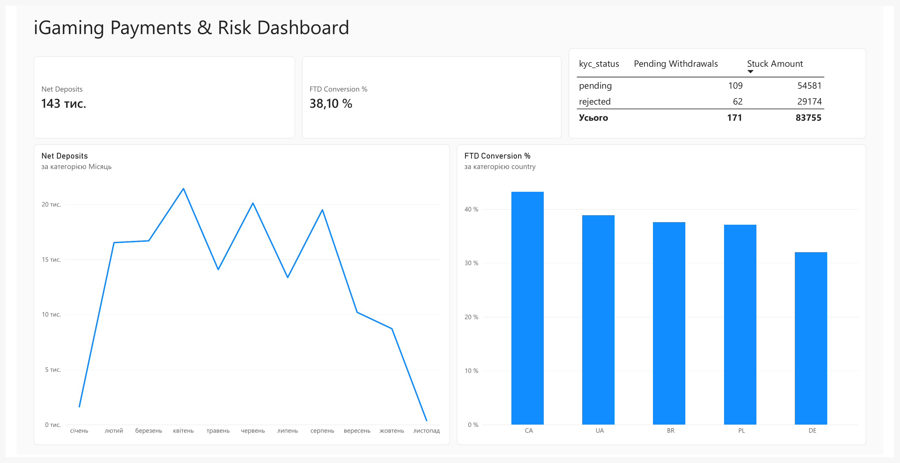

# iGaming Payments & Risk Analytics

End-to-end data pipeline and Power BI dashboard for an online casino's payments: player registrations, deposits, withdrawals and KYC status.

The project answers three business questions:

1. **Which countries convert registrations into paying players best?**
2. **How much net money does the casino receive each month?**
3. **How much money is stuck in withdrawals because of unfinished or failed KYC?**



📄 [Dashboard as PDF](dashboard/igaming_dashboard.pdf)

## Tech stack

| Layer | Tools |
|---|---|
| Data generation | Python, pandas, NumPy |
| Storage & transformation | DuckDB, SQL |
| Orchestration | Python (`run_pipeline.py`) |
| Visualization | Power BI (DAX measures, star schema) |
| Version control | Git, GitHub |

## Pipeline architecture

```
generate_players.py ─┐
                     ├─► data/raw/*.csv ─► raw ─► staging ─► mart ─► data/marts/*.csv ─► Power BI
generate_transactions.py ┘                 (DuckDB)
```

| Layer | What happens | Files |
|---|---|---|
| **raw** | CSV files loaded into DuckDB as they are | `scripts/load_to_duckdb.py` |
| **staging** | Cleaning: trimmed text, consistent letter case (views) | `sql/01_staging.sql` |
| **mart** | Star schema: `dim_players` + `fact_transactions` (tables) | `sql/02_marts.sql` |
| **analysis** | SQL answers to the business questions | `sql/analysis/*.sql` |

### Data model (star schema)

- **`dim_players`** – one row per player: country, registration date, KYC status, first deposit date (FTD).
- **`fact_transactions`** – one row per deposit or withdrawal: amount, date, status, payment method, and `signed_amount` (deposits `+`, withdrawals `−`) for net deposit calculations.

Relationship: `dim_players` 1 ─► * `fact_transactions` on `player_id`.

### Synthetic data

Real casino data is confidential, so the data is generated with business rules based on how iGaming payments work:

- 1,000 players across 5 countries; ~60% register but never deposit (bonus hunters, window shoppers), giving a realistic FTD conversion of ~38%.
- A deposit can only happen after registration; ~10% of deposits are declined.
- A withdrawal can only follow an approved deposit and goes out through the same payment method.
- **Withdrawals from players without approved KYC stay `pending`** – the same rule a real casino back office applies.

A fixed random seed (`42`) makes the data fully reproducible.

## Key findings

**1. Higher conversion ≠ more money.** Canada has the best FTD conversion (43.2%), but Ukraine brings twice the net deposits (~48.7K vs ~24.5K) because it has more than twice as many players. Marketing decisions should look at both conversion and volume.

**2. The latest month is incomplete.** November shows only 368 in net deposits because the data ends on November 8. Partial periods must be excluded or clearly labelled, or the dashboard suggests a collapse that didn't happen.

**3. 83,755 is stuck in pending withdrawals because of KYC.**

| KYC status | Pending withdrawals | Players | Stuck amount |
|---|---|---|---|
| pending | 109 | 60 | 54,581 |
| rejected | 62 | 33 | 29,174 |

Recommendations:
- **KYC pending** – these players want their money, so they are motivated to finish verification. Send reminders explaining which documents are missing and review the largest amounts first. Long withdrawal delays are a top reason for complaints and player churn.
- **KYC rejected** – explain the reason and allow resubmission, but first check these players for fraud signals (multi-accounting, third-party cards, bonus abuse). A rejected KYC combined with a withdrawal request is a classic risk flag.

## How to run

```bash
python -m venv .venv
source .venv/Scripts/activate        # Windows (Git Bash); use .venv/bin/activate on macOS/Linux
pip install -r requirements.txt
python run_pipeline.py
```

The pipeline regenerates the data, rebuilds every layer, exports the mart tables for Power BI and prints the analysis results. Then open `dashboard/igaming_dashboard.pbix` and click **Refresh**.

## Project structure

```
igaming-payments-analytics/
├── run_pipeline.py              # runs the whole pipeline
├── requirements.txt
├── scripts/
│   ├── generate_players.py
│   ├── generate_transactions.py
│   ├── load_to_duckdb.py        # CSV → raw
│   ├── run_sql.py               # raw → staging → mart
│   ├── export_marts.py          # mart → CSV for Power BI
│   └── run_analysis.py          # runs sql/analysis/*.sql
├── sql/
│   ├── 01_staging.sql
│   ├── 02_marts.sql
│   └── analysis/
│       ├── 01_ftd_conversion_by_country.sql
│       ├── 02_net_deposits_by_month.sql
│       └── 03_pending_withdrawals_by_kyc.sql
└── dashboard/
    └── igaming_dashboard.pbix
```

## Author

Yelyzaveta Shapovalova – background in iGaming payments, verification and KYC (SoftSwiss back office).